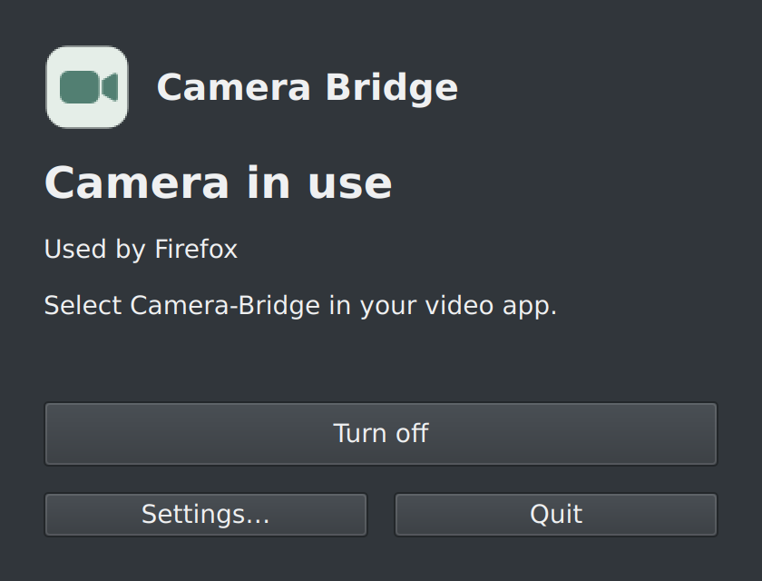
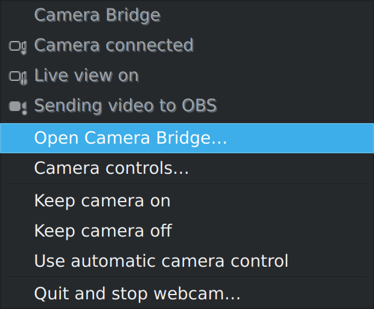
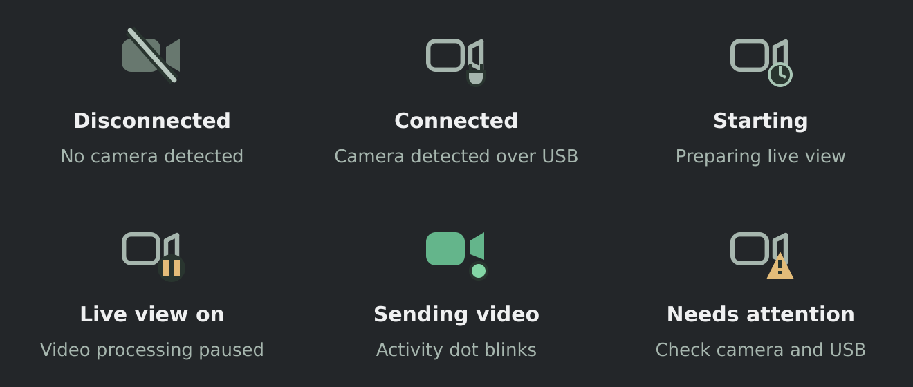
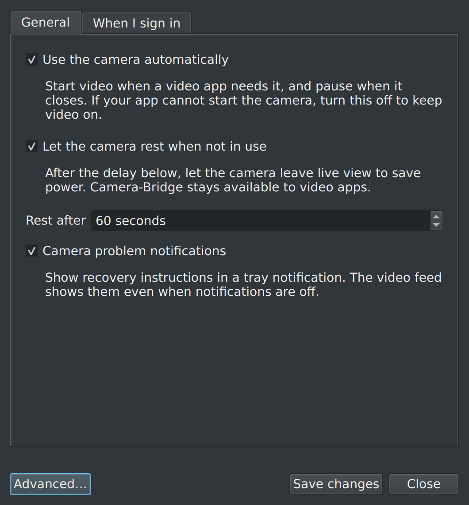
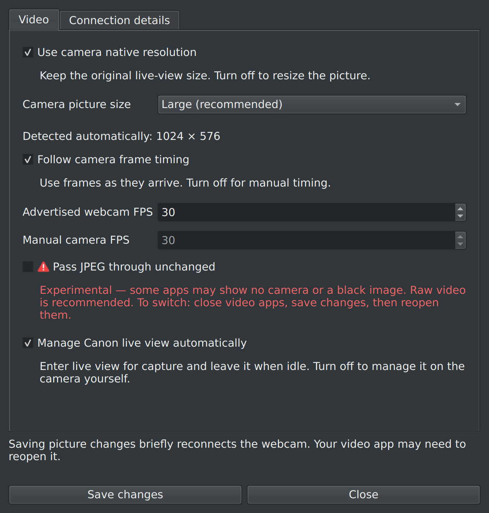
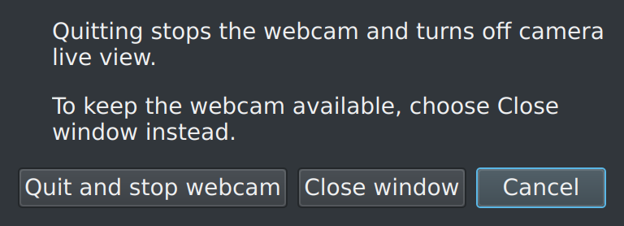
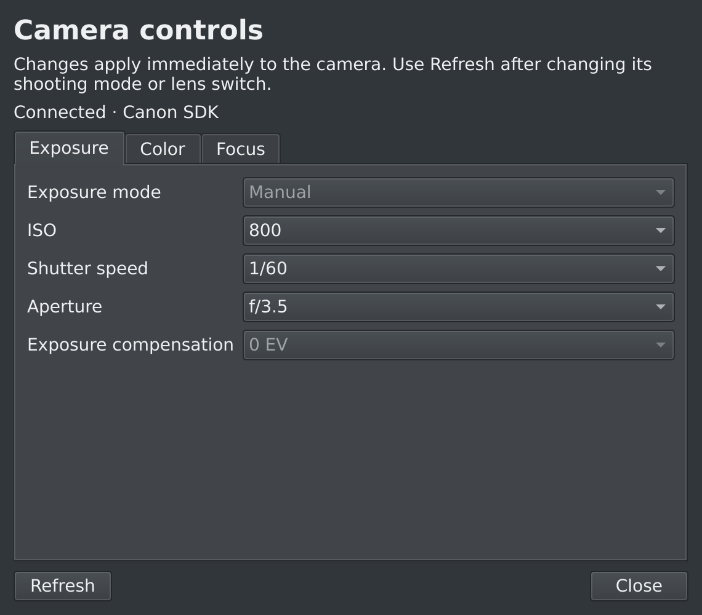
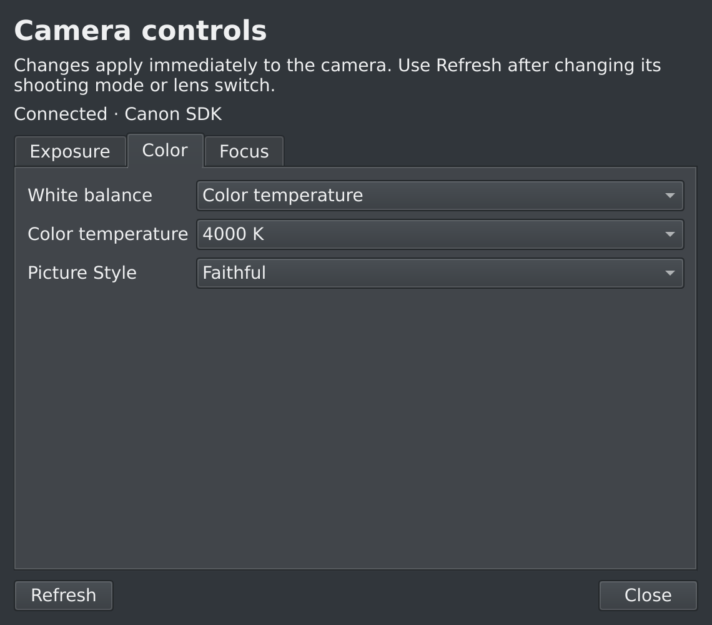
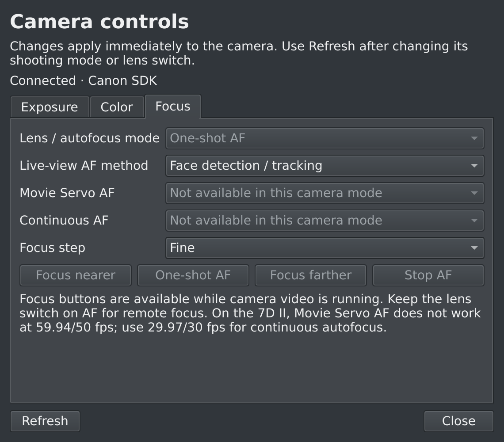
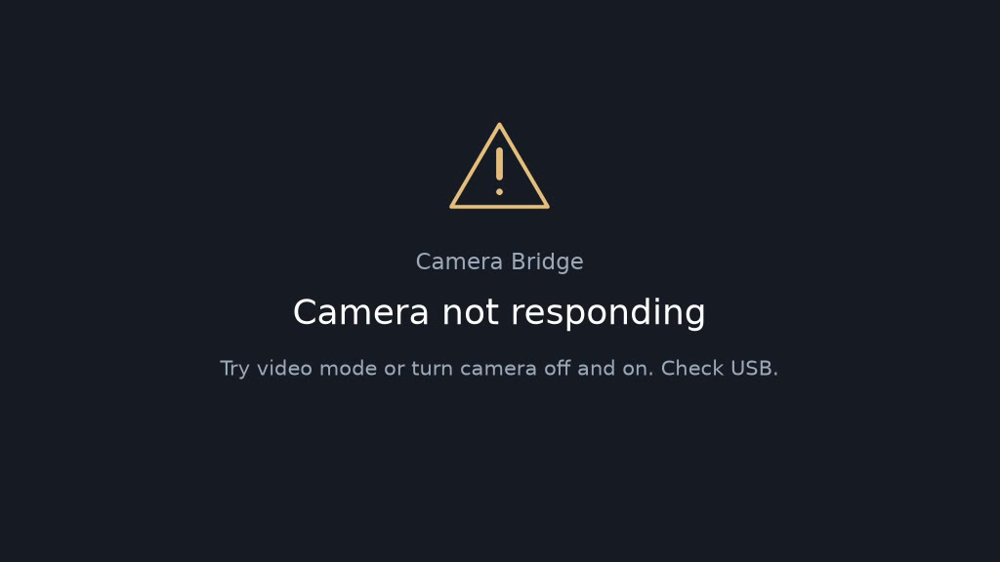

# Camera Bridge

Use a compatible Canon camera as a Linux webcam, with automatic camera control
and a simple KDE tray app. Targets Kubuntu/Ubuntu 24.04.

Open your video app to start the camera. Close its camera preview to pause video
processing; after **60 seconds** without use, the camera leaves live view.
The virtual webcam stays available while the camera rests.

Camera Bridge is an independent project, not affiliated with or endorsed by Canon.
Compatibility varies by model; hardware testing so far has used a **Canon EOS 7D Mark II**.

## Screenshots

Dark-mode renders of the actual app with demo status. The app follows your desktop theme.

| Main window | Tray menu |
| --- | --- |
|  |  |

**Tray icons**



<details>
<summary>Settings, advanced options, and quit confirmation</summary>

**Everyday settings** — automatic use, the rest delay, and notifications.



**Advanced options** — picture size, timing, and experimental JPEG passthrough.



**Quit confirmation** — close the window to keep the tray and webcam running.



</details>

## Install from APT

Add the [signed M45 Software repository](https://m45software.com/apt/) once:

```bash
sudo apt install curl ca-certificates
curl -fLO https://m45software.com/apt/m45-software-archive-keyring_1.0_all.deb
sudo apt install ./m45-software-archive-keyring_1.0_all.deb
sudo apt update
sudo apt install camera-bridge
```

[Signing-key fingerprint and setup-package checksum](docs/installation.md#add-the-repository-once).
The repository targets Ubuntu 24.04 (amd64). Updates arrive through your normal
system updates; quit and reopen the tray app after upgrading.

APT installs the required dependencies, including the virtual webcam driver.
Reboot if the webcam device is missing after installation. Secure Boot may require
approving the driver signing key when prompted.

### Install a .deb instead

Download a package from [Releases](https://github.com/M45-Software/Camera-Bridge/releases),
then install it from the download folder:

```bash
sudo apt install ./camera-bridge_0.3.1_amd64.deb
```

To build it yourself, see [development instructions](docs/development.md).
If you used the older script installer, follow the
[migration instructions](docs/installation.md#upgrading-from-the-script-installer) first.

## Start using your camera

1. Connect the camera with a USB **data** cable and turn it on. Try **video/movie
   mode**, and disable camera Wi-Fi if it prevents USB access.
2. Open **Camera Bridge** from your application menu and click **Turn on**.
3. Open OBS, Zoom, Discord, or another video app and select **Camera-Bridge**.

**If a video app was already open, close and reopen it to refresh its camera list.**
Settings save automatically. If saved changes need to reconnect the webcam,
choose **Apply to current video…** when ready; a dialog explains when to reopen
your video apps.

Native live-view resolution and automatic frame timing are enabled by default.
The tested EOS 7D Mark II supplies a 1024 × 576 live-view image; other models may differ.

Canon SDK capture is preferred automatically, with gphoto2 as a fallback. The
amd64 package includes the runtime, so users do not need the developer SDK.
Choose **Settings → Advanced → Video → Capture backend** to force Canon SDK or
gphoto2. Explicit choices disable fallback; Automatic is the default.
On the tested 7D Mark II, SDK capture delivered about 30 FPS versus about 15 FPS
with gphoto2, at the same native resolution. Actual rates depend on camera settings.
See [third-party runtime notices](THIRD_PARTY_NOTICES.md).

## Controls and status

The tray menu and tooltip show whether the camera is connected, whether live view
is on, and whether video is being sent to an app. A green activity dot blinks only
while camera images are arriving.

**Make webcam available at login** and **Show tray icon at login** are on the
main window and enabled by default. Each can be turned off independently.

**Settings** contains automatic use, the rest delay, and problem notifications.
**Advanced** contains picture settings and connection details. All changes save
automatically. **Close window** leaves the tray and webcam running. **Quit…**
asks before stopping the webcam and leaving camera live view.

The tray also offers **Keep camera on**, **Keep camera off**, and **Use automatic
camera control**. These temporary overrides preserve the virtual device and reset
when the webcam service restarts.

Open **Camera controls…** from the main window or tray for a separate window with
**Exposure**, **Color**, and **Focus** tabs. Available controls include ISO,
shutter speed, aperture, exposure compensation, white balance, Kelvin temperature,
Picture Style, live-view AF method, and one-shot or near/far focus. Changes apply
immediately to the camera and remain camera settings; opening the window does
not reset them. Refresh reads changes made on the camera itself.

Choices come from the camera's current mode and lens. Unavailable settings stay
disabled. The exposure dial and lens AF/MF switch must be changed on the camera.
Live controls share the Canon SDK capture session; gphoto2 cannot share its USB
connection, so select the Canon SDK backend to change settings during video.
On the tested 7D Mark II, Movie Servo AF and Continuous AF are not exposed by
the SDK. Set Movie Servo AF on the camera. Canon also disables Movie Servo AF
at 59.94/50 fps on this body; use 29.97/30 fps for continuous autofocus
([Canon's guide](https://in.canon/en/support/8202199200)).

<details>
<summary>Camera controls window</summary>





</details>

The tray and main window show **Reconnecting…** when the camera disconnects or
live-view frames stop, returning to live status when camera frames resume.

The video feed also explains when it is waiting, starting, or unable to connect.
Large symbols remain recognizable in mirrored previews.



[More settings and video options](docs/advanced.md)

## Common problems

| Problem | Try |
| --- | --- |
| Webcam missing in a video app | Turn on Camera Bridge, then close and reopen the video app. Reboot once if the virtual driver was just installed. |
| Camera not connected | Check power, the USB data cable, and the camera's USB/Wi-Fi settings. |
| Camera not responding | Try video/movie mode. Turn the camera off, unplug USB, then turn it on and reconnect. |
| App is open but the camera does not start | Some apps hide camera use from detection. Turn off **Use the camera automatically** in Settings to keep video on. |
| JPEG passthrough gives no picture | Turn off experimental JPEG passthrough in Advanced, apply the saved change, then reopen your video app. Raw video is the default. |

For more details, open **Settings → Advanced → Connection details → View logs**, or run:

```bash
camera-bridge doctor
camera-bridge logs
```

## Update or remove

Quit the tray before installing a newer `.deb`, then reopen Camera Bridge.
Saved preferences are retained.

To remove it, turn off both login options on the main window, quit the app, then run:

```bash
sudo apt remove camera-bridge
```

[Installation and APT setup](docs/installation.md) ·
[Advanced usage](docs/advanced.md) ·
[Building and testing](docs/development.md)
