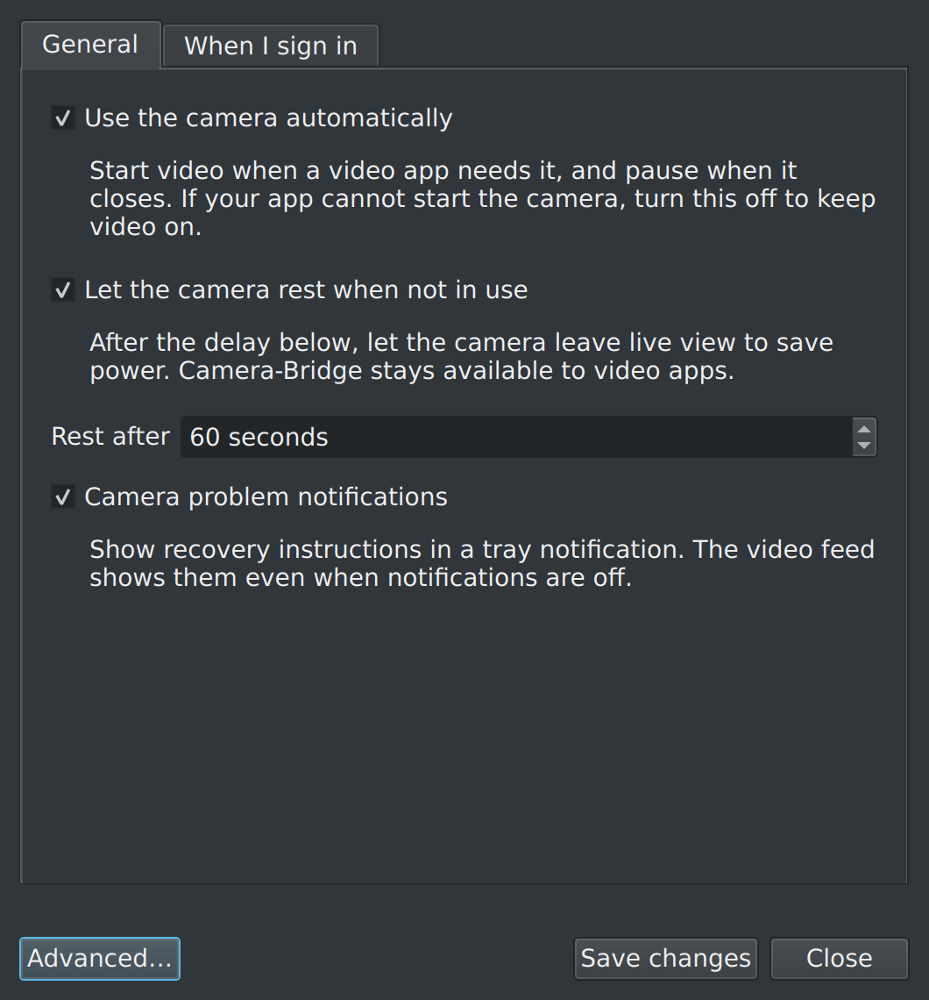
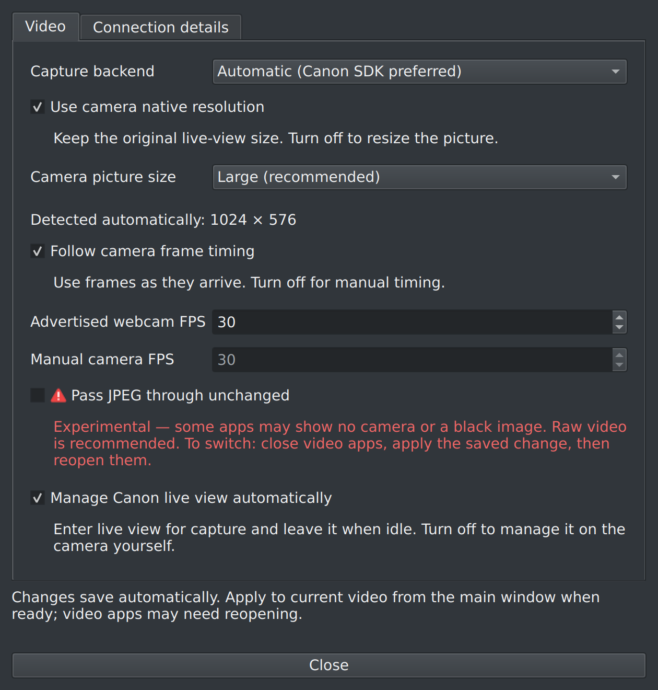
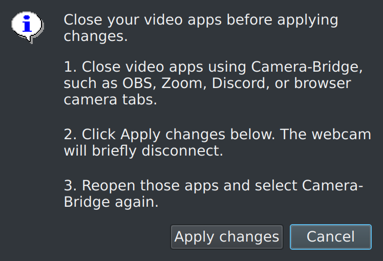
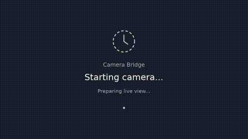

# Advanced usage

[Back to README](../README.md)

Most users can keep the defaults. These controls are under **Settings → Advanced**.

## Capture backend

The Video tab offers **Automatic (Canon SDK preferred)**, **Canon SDK**, and
**gphoto2**. Automatic uses the bundled Canon runtime and falls back to gphoto2 if
the runtime cannot load, the camera is unsupported, capture crashes, or no frames
arrive for 12 seconds. An explicit backend choice disables fallback and reports
capture errors through the usual camera status and logs. Changes save
automatically; apply them to reconnect a running webcam.

The runtime is bundled in the Linux amd64 package. Other source-install platforms
can use gphoto2. No Canon account, subscription, headers, or compiler is needed
to run the bundled backend. Native dimensions are detected using the selected
backend. Raising webcam output FPS does not increase the camera's source FPS.

```bash
camera-bridge stream --backend auto
camera-bridge stream --backend edsdk
camera-bridge stream --backend gphoto2
```

For diagnostics, `CANON_WEBCAM_EDSDK_LIBRARY` can point to a different local
runtime. The selected backend is stored as `CAPTURE_BACKEND=0` (Automatic), `1`
(Canon SDK), or `2` (gphoto2). Runtime provenance and notices are in
[THIRD_PARTY_NOTICES.md](../THIRD_PARTY_NOTICES.md).

## Picture size and timing

**Use camera native resolution** and **Follow camera frame timing** are enabled
by default. **Camera picture size** requests Large when supported; Keep camera
setting, Medium, and Small are alternatives. Unsupported size controls are ignored.

The app reads JPEG dimensions automatically without saving footage. Settings
labels the detected size or a reused, last-known size. The tested EOS 7D Mark II
supplies 1024 × 576 in Large mode; this is USB live-view size, not recorded-movie
or still-photo resolution.

Before a measurement is available, output falls back to 1280 × 720. Once an app
connects, output dimensions remain fixed until the webcam reconnects. Native-size
information is cached in `~/.config/canon-webcam/native-size.json`.

The virtual webcam advertises 30 FPS by default. Actual distinct camera frames
can arrive more slowly and vary with exposure, lighting, USB capture, and camera
state. Connection details show measured FPS. Increasing the advertised rate does
not create more camera images. Small queues limit buffering, but end-to-end
latency has not been measured.

Examples for foreground diagnosis:

```bash
camera-bridge stream --fixed-resolution --width 640 --height 480
camera-bridge stream --manual-fps --camera-fps 12 --fps 12
camera-bridge stream --auto-fps --fps 60
camera-bridge stream --live-view-size medium
```

Stop the background webcam before running a foreground stream. Stop foreground
commands with Ctrl+C.

## Raw video and experimental JPEG passthrough

The default path decodes camera JPEG images into **uncompressed YUV420**. It does
not add another lossy compression step. This is the recommended starting point
for calling and recording apps.

**Pass JPEG through unchanged** copies camera JPEGs without decoding, resizing,
or recompressing. It requires native dimensions and MJPEG support in the receiving
app. It is experimental: if an app shows no picture, return to raw video.
Both output paths have been tested with the attached EOS 7D Mark II and a loopback
reader; compatibility across common video apps still needs manual testing.

CLI equivalents are `--mjpeg-passthrough` and `--raw-video`.
Choices save automatically. If a saved change needs reconnection, the main window
shows **Apply to current video…**. Choose it when ready and follow the close/reopen
instructions. Cancel keeps your saved preferences and leaves current video unchanged.

## Automatic use and resting

The app checks readable same-user device handles roughly every quarter second.
It excludes its own video pipeline. Open/close signals interrupt the camera retry
wait; the tray refreshes every 750 milliseconds. New USB connections still need
time to settle.

An open handle indicates possible camera use, not necessarily a call or recording.
Preview/settings windows can count as use. PipeWire or another broker may appear
instead of the final app, and some protected or sandboxed apps hide their handles.
The detector does not request root privileges or change process permissions.

If an app is missed, turn off **Use the camera automatically** to keep video on.
Turning off **Let the camera rest when not in use** disables idle live-view shutdown
and the no-image timeout. With automatic use enabled, processing still pauses when
the last detected app closes the webcam.

**Manage Canon live view automatically** can be disabled if you need to operate
live view on the camera yourself. An unconfirmed state is labeled **Live view not
checked** in the tray.

Temporary command-line overrides:

```bash
camera-bridge force-start   # Keep capture running regardless of detected apps
camera-bridge force-stop    # Keep camera off, preserving the virtual device
camera-bridge auto          # Return to automatic use
```

Foreground modes:

```bash
camera-bridge stream --on-demand --timeout 60
camera-bridge stream --always-stream --timeout 0
```

Settings are stored in `~/.config/canon-webcam/settings.conf`, or under
`XDG_CONFIG_HOME`. Explicit stream arguments override saved values.
Changes save automatically after a short pause in editing. Notification-only changes
do not reconnect the webcam. Other saved changes apply at the next start, or after
choosing **Apply to current video…**. Saving while off does not turn it on.

The two login options on the main window default to on. Per-user XDG autostart
overrides store each preference independently, using `Hidden=true` for disabled
options. Turning off webcam login also disables legacy per-user service enablement.

## Recovery and status cards

A persistent writer keeps the virtual webcam open while camera capture and image
processing pause. The kernel repeats the final status image. Idle/error cards
render only on state changes; starting adds a bounded two-second pulse. Background
retries retain the warning card until real images arrive.

When an app needs video, failed capture attempts retry after a five-second recovery
delay. Reconnecting the camera or choosing **Try again** permits an immediate attempt.
A detected camera that will not start may need video/movie mode or a power cycle.

This cannot refresh an app's device list if it opened before the virtual webcam
was available. Enable **Make the webcam available at login** to initialize it earlier.
Turning the webcam off closes the writer; turning it back on may require reopening
video apps. Quitting the tray stops the webcam and asks the camera to leave live view.

## Device diagnostics

The default is **Camera-Bridge**, `/dev/video42`. Inspect setup and logs with:

```bash
camera-bridge doctor
camera-bridge status
camera-bridge logs
```

A device still carrying the older Canon-Webcam label needs its loopback device
reloaded to pick up the new label. Close all video apps before resetting it:

```bash
camera-bridge reset-loopback
```

For more extensive recovery, `camera-bridge hard-reset` stops the service, clears
stale camera/video processes targeted by the app, reloads the loopback module,
and starts the service again. Linux cannot unload it while another app holds it open.

Custom device defaults are in `/etc/modprobe.d/canon-webcam.conf`. For example:

```bash
camera-bridge setup-user --video-nr 12
camera-bridge reset-loopback --video-nr 12
```

A per-user unit overrides the packaged unit. Keep its device settings consistent
with the module configuration.

## Additional UI renders

Demo renders use the actual Qt widgets with isolated settings and a fake service.





